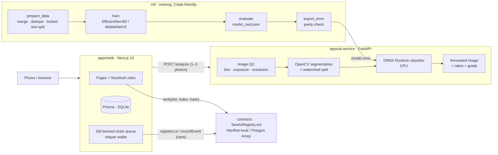

<div align="center">

# TaneİZ

**Grain-level AI quality inspection + tamper-evident supply-chain records for wheat**

Photograph a wheat sample → a computer-vision pipeline finds and classifies every kernel →
each supply-chain step is hashed onto a blockchain → anyone scanning the QR code can verify
that the record has not been altered.


[Türkçe kurulum rehberi](docs/README.tr.md) · [Demo walkthrough](docs/demo-senaryosu.md) · [Datasets](ml/DATASETS.md)

</div>

---

## Why

Wheat quality is still judged by eye. The farmer, warehouse and buyer can disagree about the same lot,
and paper slips or spreadsheets can be edited after the fact. The final buyer has no way to check a
lot's history.

TaneİZ addresses both problems:

1. **Measure:** a CV pipeline counts and classifies individual kernels (healthy, broken, insect/sunn-pest
   damaged, moldy, discolored, shriveled) and derives defect ratios and a quality grade.
2. **Seal:** every event (lot created, quality analysis, warehouse intake, purchase) is canonicalized and
   its `keccak256` hash is written on-chain. Images are included by their `SHA-256`.
3. **Verify:** a public, login-free **Product Passport** recomputes the hash from the current database
   record and compares it with the chain. Change one number in the DB and it reports **MISMATCH**.

## Architecture



| Package | Responsibility |
|---|---|
| [`apps/web`](apps/web) | Next.js App Router, Tailwind + shadcn-style UI, NextAuth (credentials, 4 roles), Prisma, chain queue, PDF/QR labels |
| [`apps/ai-service`](apps/ai-service) | FastAPI inference: image QC → segmentation → per-kernel classification → annotated image |
| [`contracts`](contracts) | `TaneIzRegistry.sol` (OpenZeppelin `AccessControl`), Hardhat tests, deploy script |
| [`packages/shared`](packages/shared) | Canonical JSON + hash functions shared by write and verify paths, ABI, types |
| [`ml`](ml) | Data preparation, training, evaluation, ONNX export, Colab notebook |

## Technical highlights

**Computer vision**
- Background estimation with illumination correction (downscaled max-filter), Otsu thresholding on a
  darkness + saturation feature, morphology and hole filling.
- Touching kernels are split with a **distance-transform + watershed** step. Per-component relative peak
  thresholds are raised adaptively only for blobs much larger than the median kernel, which avoids
  over-splitting elongated single grains (covered by tests).
- Contours are filtered relative to the median kernel area, removing dust and clumps.
- Image QC (Laplacian variance, exposure, resolution) produces warnings, not silent failures.

**Machine learning**
- Datasets with different taxonomies (WheatVision, GrainSet, a sunn-pest set) are mapped to one
  6-class schema via [`label_map.yaml`](ml/label_map.yaml).
- SHA-256 deduplication. **Group-aware stratified 70/15/15 split**, so both photos of the same kernel stay
  in the same split (no leakage).
- **The test split is locked**: its hash is stored, `evaluate.py` refuses to run if it has changed, and
  the split cannot be regenerated without `--force`.
- Training: `timm` transfer learning, class-weighted loss, label smoothing, AMP, cosine schedule, and
  domain-gap augmentation (kernels pasted onto random light backgrounds to match field photos).
- `export_onnx.py` checks PyTorch ↔ ONNX outputs on random and real test inputs (max-abs-diff and argmax
  agreement) and refuses to write a model that diverges.
- The model card page shows only numbers produced by `evaluate.py` on the locked test set. Without a model
  the inference service starts with an explicit error and returns `503`; it never fabricates results.

**Blockchain & integrity**
- Only hashes go on-chain; no personal data and no images.
- The same `hashEventData()` (sorted-key canonical JSON → `keccak256`) is used when writing and when
  verifying.
- An asynchronous DB-backed queue keeps on-chain index = per-lot sequence. It uses exponential-backoff
  retries and is **idempotent**: a transaction that landed but wasn't recorded in the DB is detected and
  not re-sent.
- Writes require `RECORDER_ROLE` (server relayer). `ADMIN_ROLE` manages recorders.

**Product**
- Mobile-first passport page: grade stamp, original ↔ AI-annotated image slider, defect breakdown,
  timeline with live per-step verification.
- 5-step producer wizard, QR label PDF, warehouse/buyer QR scanning (camera, image file or manual entry).
- `/demo/kurcala` tamper demo: edit a record in the DB, watch verification turn red, undo it, watch it
  turn green again.

## Quick start

**Docker**
```bash
cp .env.example .env     # set PUBLIC_BASE_URL=http://<your-LAN-IP>:3000 to scan QR codes from a phone
docker compose up --build
```
Web `:3000` · AI service `:8000` · local chain RPC `:8545`

**Without Docker** (Node 20+, Python 3.11)
```bash
npm install
pip install -r apps/ai-service/requirements.txt
cp apps/web/.env.example apps/web/.env
npm run db:push

npm run chain          # terminal 1: local Hardhat node
npm run deploy:local   # terminal 2: deploy + grant RECORDER_ROLE
npm run ai             # terminal 2: inference service
npm run seed           # terminal 3: demo users + 6 lots (or `npm run seed:no-ai` without a model)
npm run dev            # terminal 4: http://localhost:3000
```

Demo accounts (password `taneiz123`): `uretici@` (producer), `depo@` (warehouse), `alici@` (buyer),
`admin@taneiz.demo`. The login page also offers one-click sign-in.

**Training the model:** download the datasets ([ml/DATASETS.md](ml/DATASETS.md)), run
[`ml/train_colab.ipynb`](ml/train_colab.ipynb) on a free Colab T4 (under an hour), unzip the artifacts into
`ml/artifacts/` and `apps/web/prisma/seed-samples/`, restart the AI service, then run `npm run seed`.

## Tests

```bash
npm run test:contracts                       # 10 Hardhat tests: access control, ordering, verify true/false
npm run test:shared                          # canonical JSON + hashing
cd apps/ai-service && python -m pytest -q    # segmentation, watershed split, QC, grading rules, no-model 503
```

## Project status

- [x] Contracts, hashing and chain queue, tested end-to-end on a local Hardhat chain
- [x] Inference service: segmentation, classification and annotation, tested with an integration model
- [x] Web app: passport, verification, producer wizard, warehouse/buyer flows, tamper demo
- [x] Training pipeline: prepare, train, evaluate, export, plus Colab notebook
- [ ] Train on the public datasets and publish real test-set metrics in the model card
- [ ] Screenshots / short demo GIF
- [ ] Docker Compose run verified on a clean machine

## Design decisions & limitations

- Grade thresholds live in [`grading_rules.yaml`](apps/ai-service/grading_rules.yaml) (e.g. healthy ≥ 95% →
  grade 1). They are configurable demo values, **not an official standard**, and the UI says so.
- Moisture is **not** predicted from images. It is entered from a moisture meter and tagged as such in
  the record.
- The classifier is trained on single-kernel images; dense piles or heavy overlap reduce segmentation
  quality.
- The passport reads displayed values from the hashed event payload, so a DB tamper is both visible and
  detected.
- SQLite for the demo; switching to Postgres is a one-line Prisma provider change.

---

<sub>Built by **Rüveyda Yıldırım**, AI engineer · [github.com/ruveydayldrm](https://github.com/ruveydayldrm)</sub>
